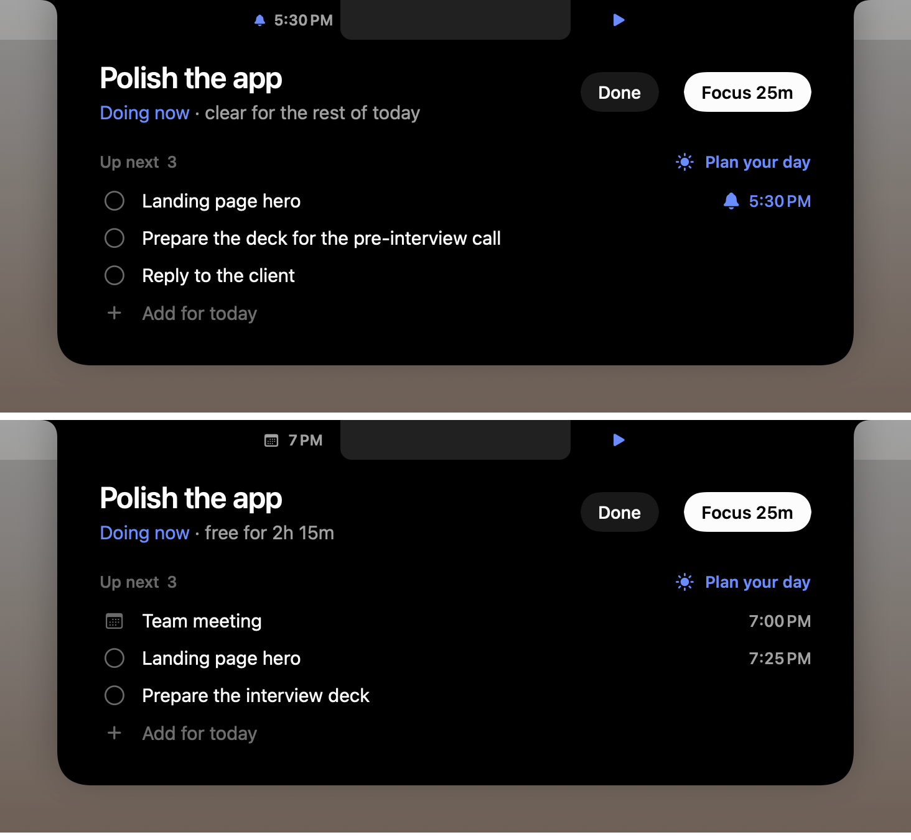
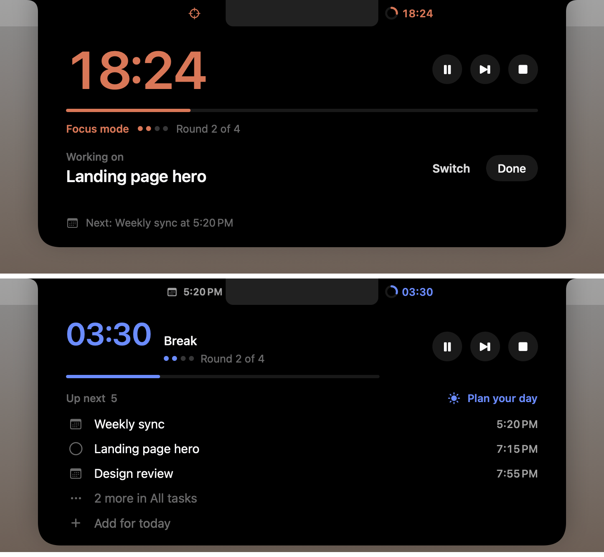
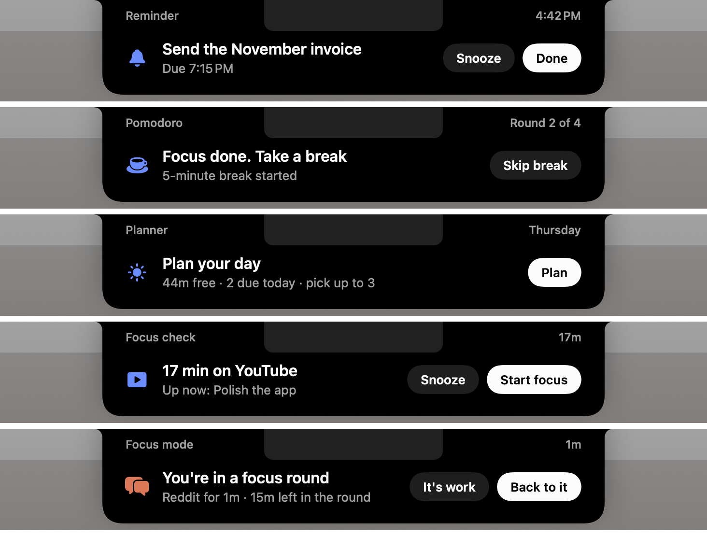
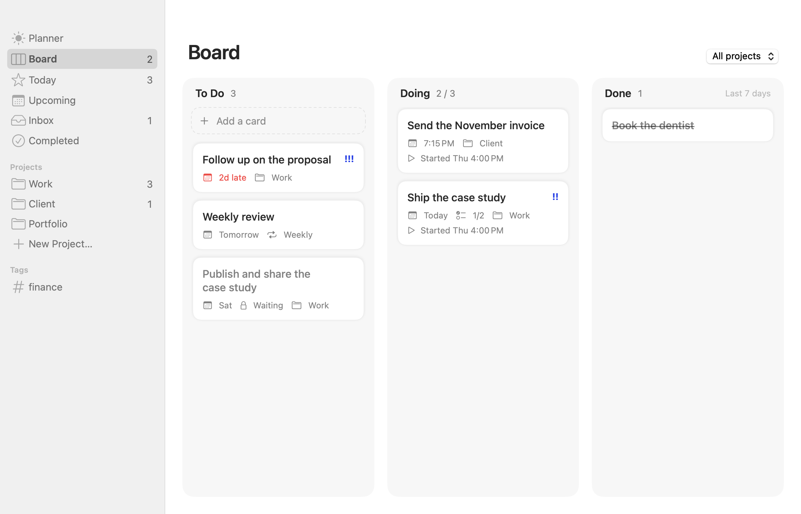
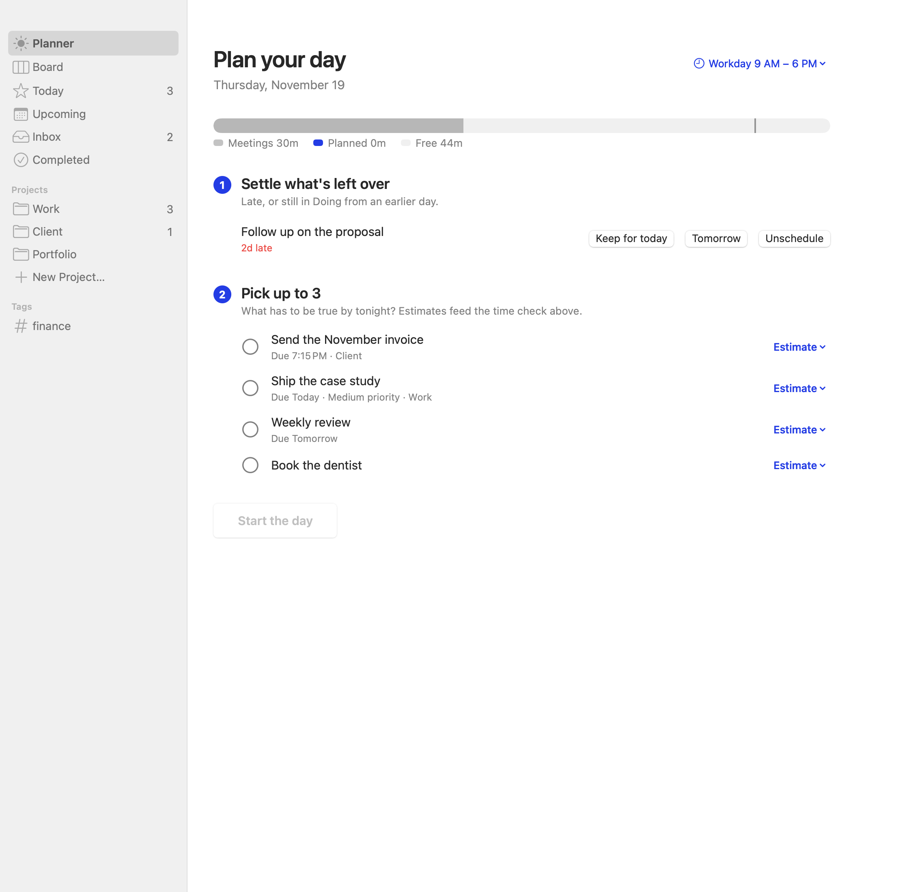
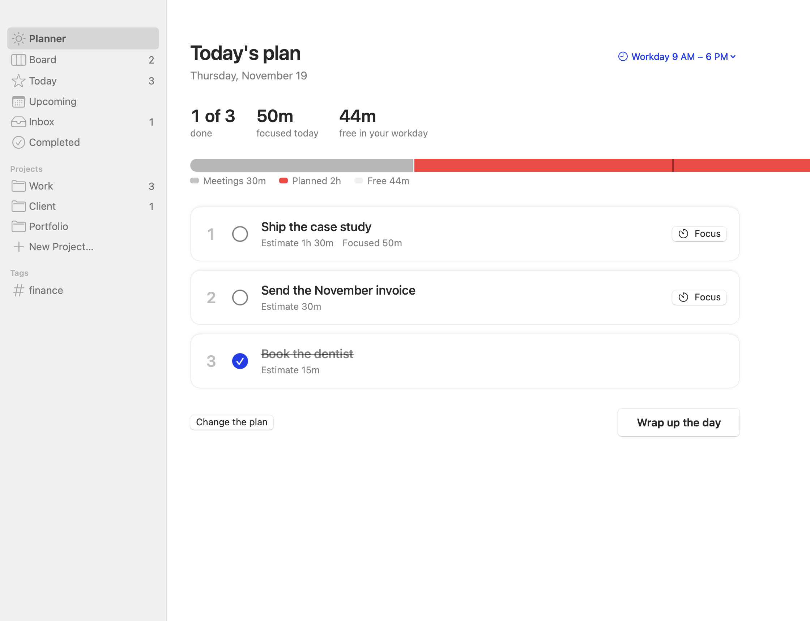
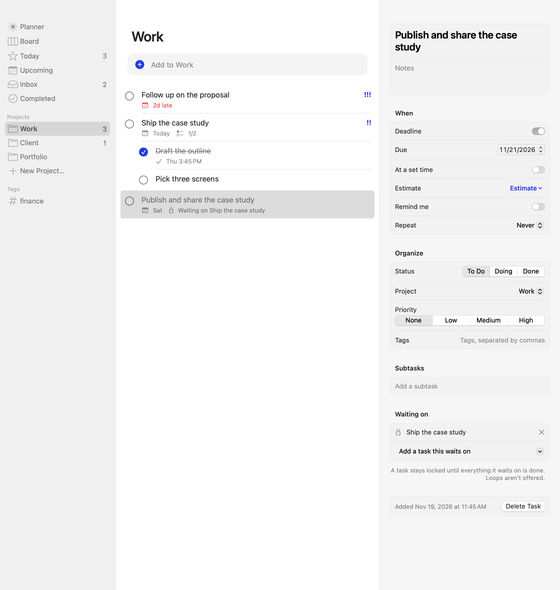
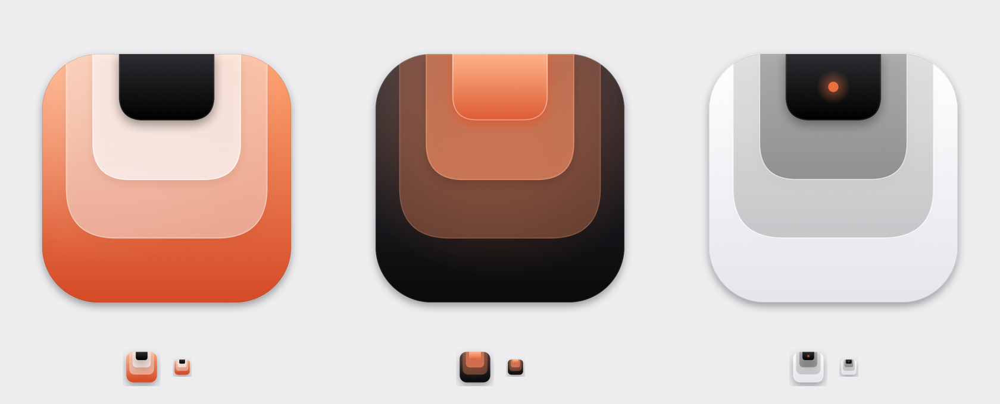

# Notch

A Mac app that lives in the MacBook notch: a glance at what's next and what's happening now,
a Pomodoro timer, a daily planner, and a Kanban board behind it. Version 0.3.1.

- **At a glance, without hovering:** compact signals beside the camera. Left: up next (your next
  meeting or task, with its time). Right: now (the timer, the meeting you're in, or the card in Doing).
- **Rest on the notch:** the panel opens. What you're doing now, then everything ahead in one list.
- **When something comes due:** a banner drops from the notch (reminders, deadlines, meetings,
  focus rounds, planning prompts) and tucks back after a few seconds.
- **Focus mode:** Pomodoro rounds in a warm orange, with distractions held until the break.
- **The planner:** pick up to 3 each morning against your free time; wrap up each evening.
- **Focus Guard** (opt-in): nudges you back to work when YouTube, games or feeds run long.
- **The task window:** a Kanban board plus lists, with projects, subtasks, deadlines, reminders,
  repeats, priority, tags and dependencies.

Everything stays on your Mac. Screenshots use sample data.

> **All rights reserved.** This code is public to read, not to reuse: no license is granted to copy,
> modify or use it elsewhere. See [LICENSE](LICENSE).

## Screenshots

**Closed.** Up next on the left, now on the right: a meeting at 7 PM with a card in Doing; a
meeting you're in; a focus round (with its progress line along the bottom); a break.


**Open.** The card you're doing leads; meetings and tasks share one list below.



**Focus mode and a break.**



**Banners.** A reminder, a finished focus round, the morning plan prompt, and two Focus Guard nudges.



**The board.**



**The planner,** morning and during the day.





**A task, open in the inspector.**



**The icon**, with two alternates drawn by the same script.



## The closed notch

**Left: up next**, in the default text color. **Right: now**, in the active color. Closed, each
side is compact, like the Dynamic Island's compact view: an icon and a short value.

| Left wing (up next) | Right wing (now) |
|---|---|
| 📅 7 PM: the next meeting, when it comes before your next timed task ("in 7m" once it's close) | ◔ 18:24: a focus round, in **orange** |
| ○ 5 PM: the next task. 🔔 when its reminder is ringing, a red ○ when it's late | ◔ 03:30: a break, in blue |
| In focus mode: a target mark, or the round dots ●●○○ | 👥 24m: time left in the meeting you're in, in blue |
| | ▶: a card in the board's Doing column, in blue |

The names are in the open panel. **Reaching for a menu under a wing makes it step aside**, and only
resting on the notch itself opens the panel.

**Up next** follows one rule: a ringing reminder first, because it needs you now. Then whichever
comes first in time, the next meeting today or the next timed task. Then a late task, then the
rest of today. Cards in Doing are "now", so they never show as "next".

**Opening the notch keeps the glance:** the same compact wings stay exactly where they were, in the
band beside the camera, and the panel grows around them.

## The open notch

- **Now, on top:** the card you're doing, in full, with **Done** and **Focus 25m**. Under it,
  "Doing now · free for 1h 43m". A meeting you're in, a break timer, or (with nothing in Doing)
  where your day stands leads instead.
- **Up next, in one list:** meetings and tasks together across the full width, so names fit.
  Order: other Doing cards, ringing reminders, late tasks, then today's meetings and timed tasks
  by time, then untimed tasks, then tomorrow's first meetings. Each row shows one fact: its time,
  "2d late", a bell, "Doing".
- **At most four rows.** More than that shows as "3 more in All tasks"; spare room shows what you
  finished today. The panel is as tall as its content.
- **Add for today** at the bottom; right-click a row for Focus on This, Start Doing, snooze.

During a focus round a thin orange line also fills along the bottom edge of the notch. Both wings
disappear when neither side has anything. Each wing keeps its full width even when empty, so
nothing ever slides under the camera.

**Colors:** soft white for up next, blue for what's happening now, a warm orange (#D97757) for focus
and nothing else, red only for overdue.

## Pomodoro

- **Start:** **Focus 25m** in the open notch, or `notch://focus`. Right-click the pill to switch plans:
  Classic (25 / 5, long 15 after 4), Deep work (50 / 10, long 30 after 3), Sprint (15 / 3, long 10 after 4).
- **Breaks start by themselves** when a focus round ends, and a banner says so (with **Skip break**).
  After the last round comes the long break.
- **The next focus round waits for you.** When a break ends, a banner offers **Start round 3**,
  and the pill says the same until you do.
- **Focus mode** (a focus round, running or paused) turns the open notch into one thing: a large
  orange countdown, **Pause**, **Skip** and **Stop**, and **Working on**. There you pick the task the
  session is for, switch it, or mark it **Done**. Task lists step away until the break; one line keeps
  your next meeting in view.
- **Focus mode holds task banners** (reminders, deadlines) until the break, then shows them in order.
  Meeting warnings still come through.
- **Focus on a task directly:** right-click any task, in the notch or the task window, and choose **Focus on This**.
- **Breaks** show in blue, with your lists back in view.
- **If the Mac sleeps through a round's end**, it moves on quietly to the next round, with no surprise
  break and no late chime.

## Banners

| When | Banner | Actions | Stays |
|---|---|---|---|
| A reminder goes off | 🔔 Reminder · task · its deadline | Snooze (10 min), Done | 9 s, then the bell count stays in the wing until you deal with it |
| More than 2 reminders at once (say, after waking the Mac) | One "3 reminders went off" banner | Show | 9 s |
| A timed deadline arrives | Due now · task | Snooze, Done | 6 s |
| A meeting is 5 minutes out | Calendar · event · start time | none | 6 s |
| A focus round ends | Pomodoro · Focus done, break started | Skip break | 6 s |
| A break ends | Pomodoro · Break's over | Start round *N* | 9 s |

Banners queue one at a time and never drop while the panel is open (you're already looking).
Click a banner's text to open the panel. Sounds: Ping for tasks, Tink for meetings, Glass when a round ends, Bottle when a break ends.

## The planner

A daily loop, about two minutes at each end of the day. It lives at the top of the task window's
sidebar, and the window opens on it while today still needs a plan.

**Morning: plan your day.**
1. **Settle what's left over:** tasks that are late, or still in Doing from an earlier day.
   **Keep for today**, **Tomorrow**, or **Unschedule** (no deadline, back in To Do).
2. **Pick up to 3**, best candidates first: ringing, late, due today, in Doing, then priority.
   Give each an estimate.

The time bar shows your remaining workday split into meetings, planned work, and free time, with
a mark at 80%. Past that mark the plan has no buffer left ("No buffer left. Consider cutting one."),
following the contract rule that no plan fills 100% of the time. **Start the day** puts the picks
in Doing (and moves anything else out), so the board and the notch show exactly today's plan.

**During the day:** the plan as three cards, each with its estimate and the focus time logged
against it (red when it runs over), and a **Focus** button that starts a round on it. Up top: done
count, focus time today, free time left. **Change the plan** goes back to picking.

**Evening: wrap up your day.** See what got done, then decide where each unfinished pick goes:
**Tomorrow**, **Back to To Do**, or **Done**. Write one line for **Tomorrow, start with…**; it opens
tomorrow's plan.

**The notch asks:** "Plan your day" drops at the start of your workday, and "Wrap up your day" at
its end if the day was planned. Weekdays only, once each, held while you're in a focus round. Until
you plan, the open notch's Today column shows a **Plan your day** link. Your workday defaults to
9 AM – 6 PM; change it from the menu at the top of the planner.

**Focus time is recorded:** every focus round, or part of one if you skip or stop, is logged against
the task you were working on. That gives the planner's estimated-vs-actual comparison.

## Focus Guard

Nudges you back to work when a distraction runs long. **Off unless you turn it on.** Right-click
empty space in the open notch › Focus Guard.

- **What counts** (choose in the menu): Games (any app in macOS's Games category, plus Steam),
  Video (YouTube, Netflix, Prime Video, Hotstar, aha, Twitch and similar, plus TV, VLC, IINA),
  Social feeds (Reddit, Instagram, Facebook, TikTok), and X and LinkedIn as a separate choice.
- **When:** after 15 minutes during your workday, after 1 minute in a focus round (Balanced). Gentle
  waits 30 minutes; Strict, 5. Never during a break or outside your workday.
- **The nudge** drops from the notch. In the workday: **Snooze** (15 minutes) or **Start focus** on
  what's in Doing. In a focus round: **It's work** (no nudges for an hour) or **Back to it**.
- **Glances are forgiven:** switching away for under a minute doesn't reset the clock, and hopping
  between distractions counts as one stretch.
- **The evening wrap-up** shows the day's total ("YouTube 40m · Reddit 10m").

**If nudges never come for websites:** macOS may have blocked Notch from asking the browser.
The Focus Guard menu then shows ⚠︎ and "Allow in System Settings…", which opens Privacy & Security ›
Automation; turn on your browser under Notch. `open "notch://guard-check"` writes what Notch can see
to the system log:
`log show --last 5m --info --predicate 'subsystem == "com.dineshrevunuru.notch"'`.

**What it reads, and what it keeps:** the front app's name and category every 20 seconds and on
every app switch, only while a nudge could apply. For Chrome and Safari, it also reads the active
tab's address, which needs a one-time macOS prompt ("Notch wants to control Google Chrome").
Firefox can't be asked. It never sees the screen. Only a name like "YouTube" and the minutes are
saved, in `store.json`; addresses are not.

## The board

The task window opens on the **Board**:
- **Columns:** **To Do**, **Doing** and **Done** (the last 7 days).
- **Moving cards:** drag a card to another column, or drop it onto a card to place it above. Right-click for Move to…, Focus on This, or Delete.
- **Doing is "now":** its first card shows on the right of the notch. The column says so when it holds more than 3 at once.
- **Done means finished:** dropping a card there completes it (subtasks and repeats included), and dragging it back out reopens it.
- **Focus moves cards too:** focusing on a task moves it to Doing.
- **Filter** the board by project from the menu at the top. Cards show only what applies: deadline (red when late), subtasks, waiting, repeat, project, when it started.

## The task window

- **Sidebar:** Board, Today (overdue + due today + ringing), Upcoming (by day), Inbox (no project),
  Completed, your projects, and every tag in use. Right-click a project to rename or delete it;
  deleting moves its tasks to the Inbox.
- **Lists:** the add field at the top files into what you're looking at: Today gets today's date,
  Upcoming gets tomorrow's, a project gets that project, a tag gets that tag. Subtasks sit indented
  under their parent. Right-click a row for priority, move, or delete.
- **Inspector:** select a task to edit it.
  - Deadline: a day, or a day and a time.
  - Reminder, with snooze and dismiss while it rings.
  - Repeat: daily / weekly / monthly / yearly, every *N*.
  - Project, priority, tags.
  - Subtasks.
  - **Waiting on:** tasks this one can't start before. A waiting task shows a lock until they're done.
    Choices that would make a loop aren't offered.

### Rules worth knowing

- **Finishing a task finishes its subtasks.**
- **Finishing a repeating task** schedules the next one on schedule from the old deadline, skipping
  dates already past. Its reminder and subtasks come along, fresh.
- **Dismissing a reminder** stops it ringing but keeps the reminder time, so repeats keep reminding.
- **Deleting a task** deletes its subtasks and frees anything that was waiting on them.
- **Moving a task** to another project moves its subtasks too.

## Icon

One mark: the notch opening. Three layers hang from the top edge of an orange tile, one for
each state of the app (closed, glance, open), drawn as stacked sheets of glass with the black notch
at the core. It's drawn in code by `scripts/make-icon.swift`:

```bash
swift scripts/make-icon.swift --explore /tmp/icons.png          # aurora, ember, mono side by side (--all adds the older ones)
swift scripts/make-icon.swift --style aurora --icns Resources/AppIcon.icns   # the current icon
```

## Sharing it

```bash
scripts/build-app.sh --share     # universal (Apple Silicon + Intel) build: dist/Notch-<version>.zip + How to open Notch.txt
```

Send the zip **and** `How to open Notch.txt` (or paste its steps in your message). The note has
to travel outside the zip: macOS blocks an unnotarized app before anyone can read what's packed
with it. There's no disk image for now. Until the app is notarized, macOS blocks a disk image too,
which means two approvals instead of one.

The zip holds only the app: no tasks, no calendar data, nothing personal. Each person gets their
own empty list. It needs macOS 14 or later, and it has only been tested on macOS 27, Apple Silicon.

**As built today (ad hoc signature):** the recipient unzips it, drags Notch to Applications, and
opens it. macOS blocks it the first time. They then go to System Settings › Privacy & Security and
click **Open Anyway**, then **Open**. Since macOS 15 there's no Control-click shortcut around this.

**To make it open normally for anyone:** join the Apple Developer Program ($99/year), create a
Developer ID Application certificate, then build with `SIGN_IDENTITY="Developer ID Application: …"`
and notarize the zip with `xcrun notarytool`. The build already uses the hardened runtime and
declares calendar access in `Resources/Notch.entitlements`, both of which notarization needs.

## Links

Shortcuts, Raycast, or your own scripts can drive it:

```
notch://open    notch://close    notch://toggle    notch://tasks    notch://planner
notch://focus      notch://focus?minutes=50      notch://focus/pause   /resume   /skip   /stop
notch://add?title=Send%20invoice&project=Client&due=tomorrow
```

`due` takes `today`, `tomorrow`, `2026-11-20`, or `2026-11-20T15:00`. A `project` that doesn't exist yet is created.

## Where things live

- **Tasks, projects, day plans and the focus log:** `~/Library/Application Support/Notch/store.json`. It's human-readable
  JSON, and the app picks up outside edits within a minute; an entry only needs `id`, `title` and
  `createdAt`. An unreadable file is kept as `store.unreadable-<time>.json` rather than overwritten.
  The first version's `tasks.json` is migrated into the Inbox once, then kept as `tasks.v1-migrated.json`.
- **`Sources/NotchCore`:** logic with no UI (task model and rules, store, alert planner, status
  lines, Pomodoro timer), all covered by `swift test`.
- **`Sources/Notch`:** the panel over the notch, pointer handling, SwiftUI views, EventKit, and the
  task window (`Tasks/`).

## How it sits on the notch

The panel is borderless, one level above the menu bar, on every Space and over full-screen apps.
While closed it ignores the mouse, so the menu bar under it keeps working. A banner takes the
pointer only while the pointer is over it. Pointer position comes from event monitors (mouse
events need no Accessibility permission). The notch size comes from the screen's
`auxiliaryTopLeftArea` / `auxiliaryTopRightArea`. On a Mac without a notch, it draws a
menu-bar-height stand-in at the top center.

The task window brings Notch into the Dock and ⌘-Tab while it's open, and takes it back out when it closes.

Motion uses springs, so it feels like the Dynamic Island: opening settles in
0.42 s with a slight give, closing takes 0.3 s with no bounce, and the wings morph in 0.38 s.
The notch opens after the pointer rests on it for 70 ms, and closes 260 ms after it leaves.
Springs keep their momentum when interrupted (hover in, then away mid-open), which is what makes
them read as fluid. Everywhere else, motion uses plain ease-out curves with no overshoot. The open panel's content is always built and revealed as the shape grows,
so nothing is created at the moment it opens. Reduce Motion swaps everything for short fades.
Red appears only for overdue.
